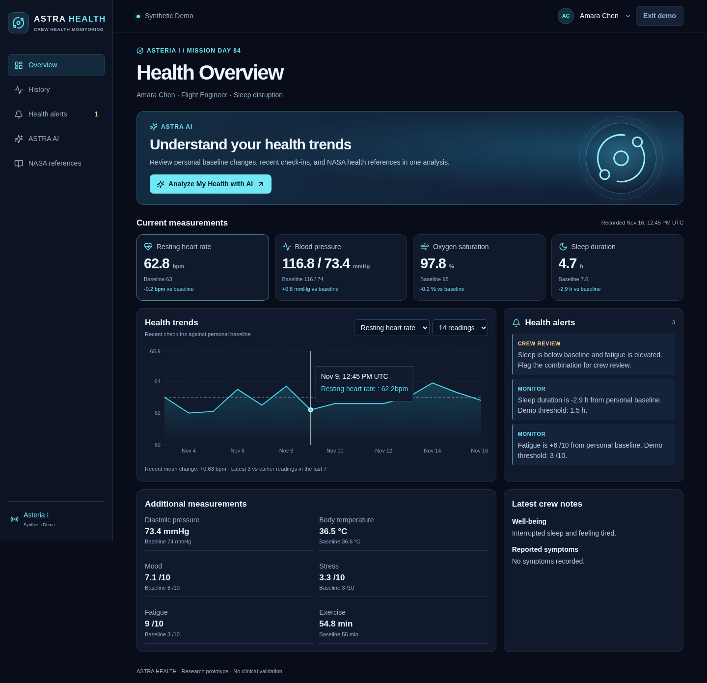
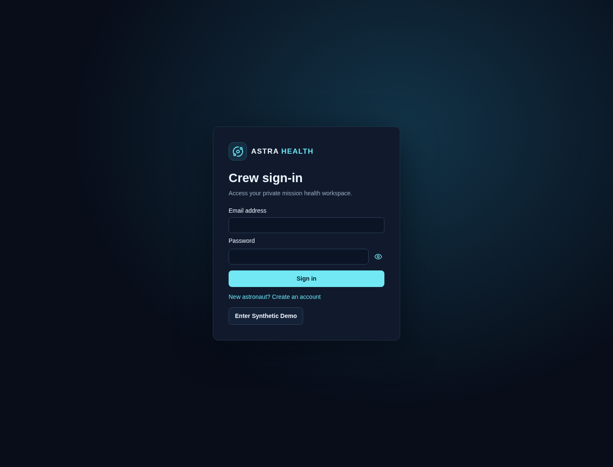
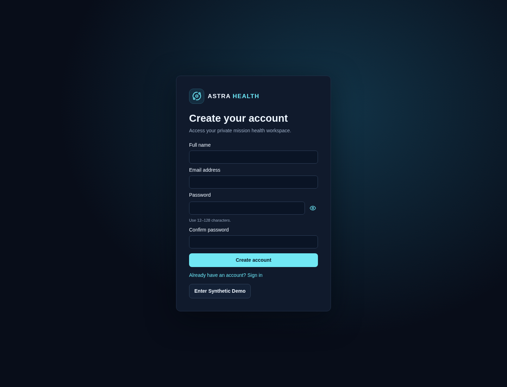
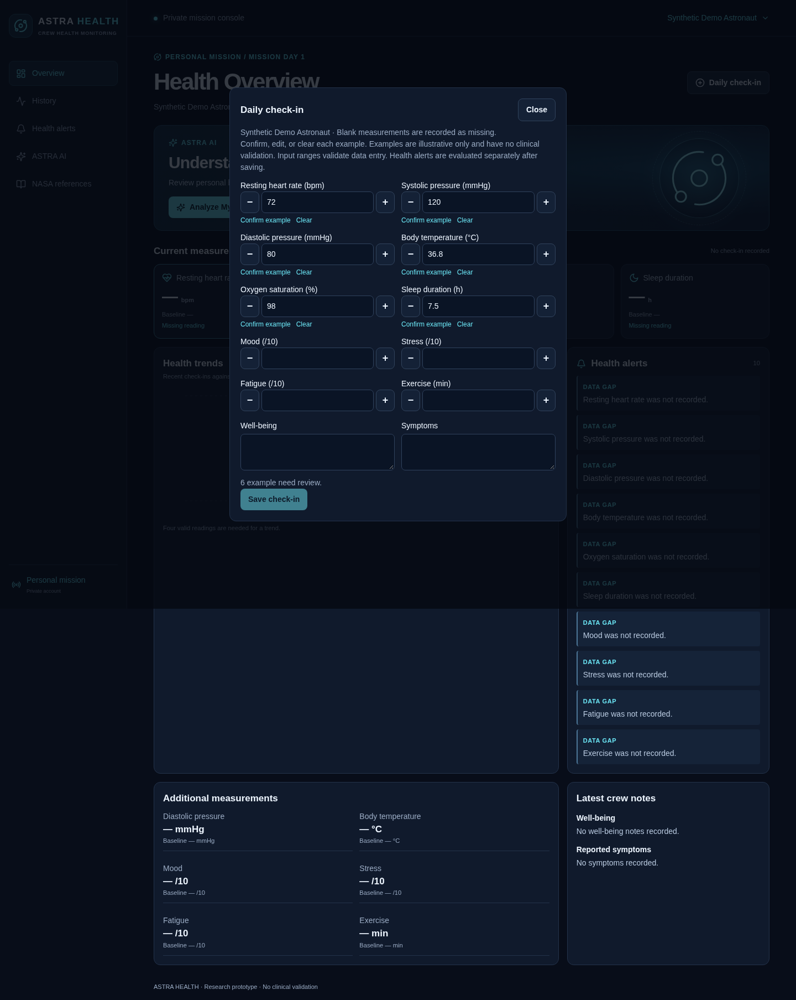
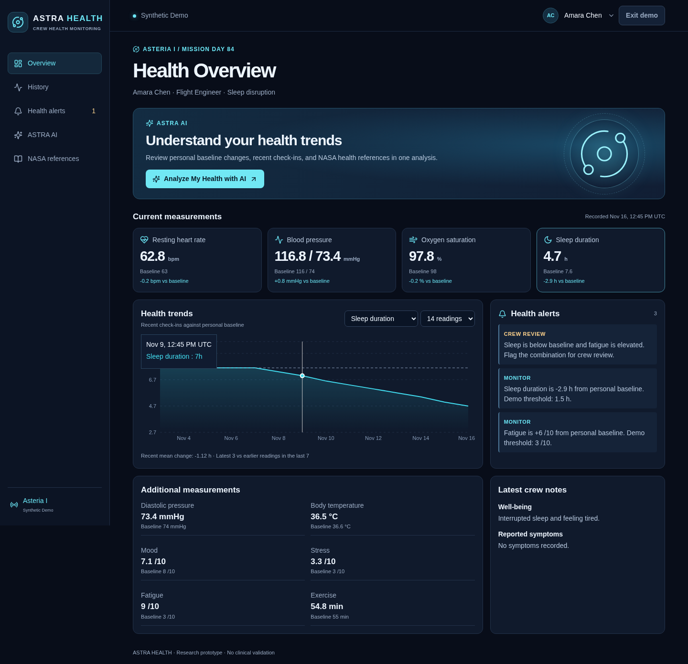
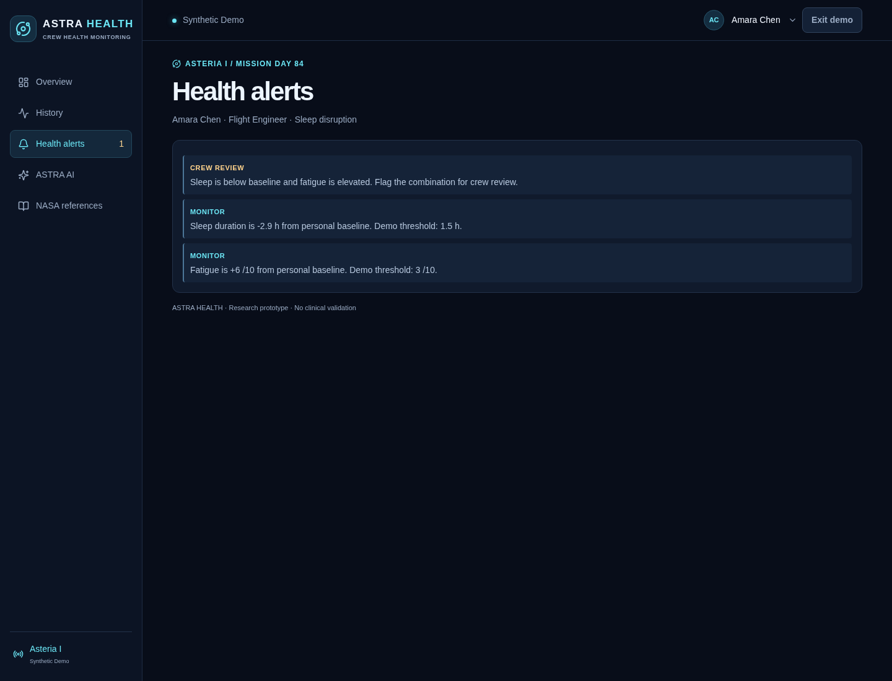
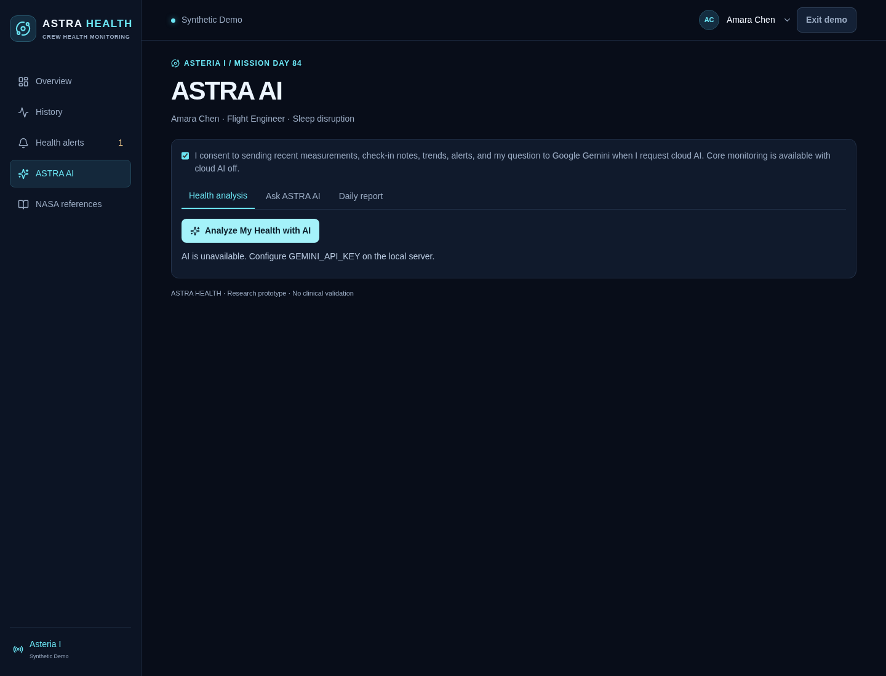
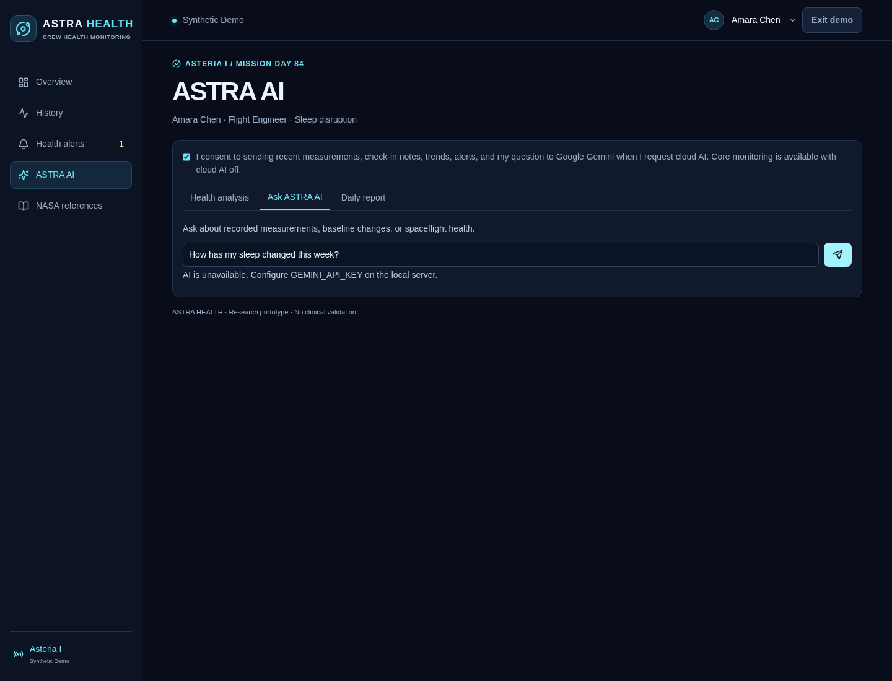
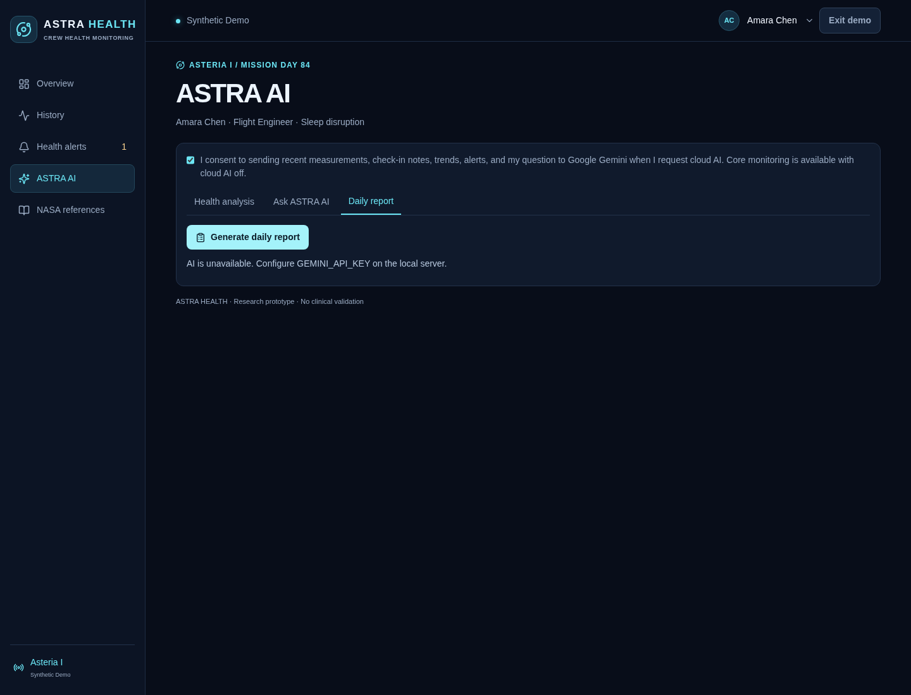
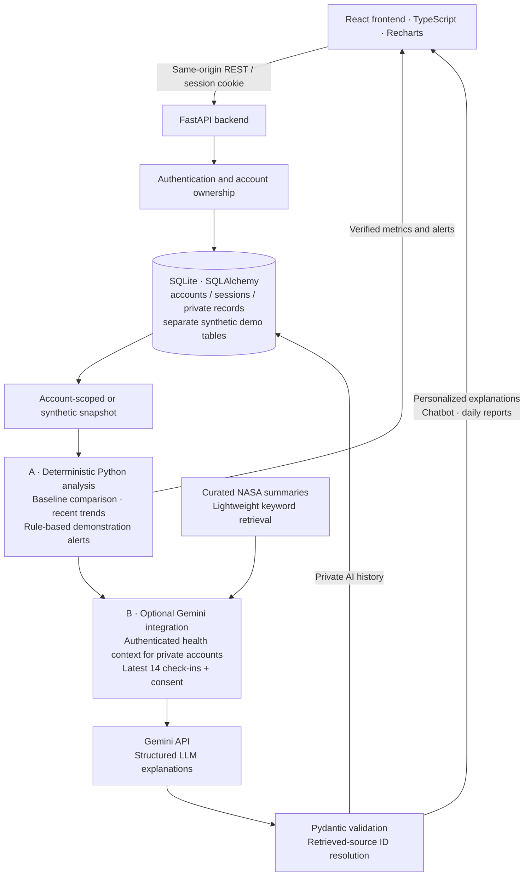

# ASTRA HEALTH

### An applied AI and software engineering prototype for astronaut health monitoring

     



## Project overview and motivation

ASTRA HEALTH explores how a full-stack monitoring system can organize longitudinal health records, compare measurements with personal baselines, expose interpretable demonstration alerts, and optionally generate contextual explanations through an LLM API. The goal is to make the distinction between recorded evidence, deterministic calculations, and generated interpretation visible to the user.

The prototype combines a React interface, a FastAPI REST API, SQLAlchemy data models and local SQLite persistence. It demonstrates account-scoped data access, time-series visualization, structured response validation and lightweight retrieval of curated scientific references. All bundled crew identities, missions, measurements and thresholds are fictional. **This is not a medically certified product and has no clinical validation.**

## NASA Space Apps Challenge context

Project context supplied by the contributors: **NASA Space Apps Challenge 2026**, challenge **“Create Health Monitoring Software for Astronauts on Space Missions”**, team **AstraNova**. This repository presents the team's research prototype; it does not claim NASA endorsement, an award, or deployment in a space mission. See the [NASA Space Apps website](https://www.spaceappschallenge.org/) for the official program.

## Key features

| Capability | Engineering contribution |
| --- | --- |
| Private account workspace | Argon2id password hashing, revocable sessions and server-derived record ownership |
| Daily check-in | Ten measurements, optional notes, bounded input validation and explicit review of example values |
| Personalized time-series analysis | Baseline offsets and recent mean comparisons with visible sample counts |
| Interactive chart and history table | Select metric and 7/14-reading window; inspect chart values with tooltips |
| Explainable demonstration alerts | Separate missing/stale data, baseline deviations and combined crew-review rules |
| Optional Gemini analysis, chatbot and report | Consent-gated requests, curated NASA context and validated JSON response structure |
| Synthetic demo | Three read-only scenarios; core monitoring requires no API key |

<details>
<summary>Application screenshots — captured from the running application</summary>

**Login and registration**




**Daily check-in** — fictional local account; example values require confirmation before saving.



**Interactive chart** — fictional sleep-disruption scenario, sleep metric selected.



**Rule-based health alerts** — demonstration thresholds, not medical criteria.



**Gemini analysis, chatbot and daily report interfaces** — no API key was configured during capture. These screenshots show the real unavailable-service response, not generated AI output. Live response quality and report download were not verified.





See [capture provenance](docs/screenshots/README.md).
</details>

## System architecture



The backend owns calculations and access control. SQLite simplifies local reproducibility, while JSON record fields make the prototype compact; this trades away some database-level schema constraints and is not a substitute for a production migration strategy. A hosted LLM adds explanatory flexibility but introduces network, privacy, quota and factual-reliability constraints. Demo endpoints are public and separate from authenticated private data.

## AI integration and methodology

Gemini explains supplied evidence; it does not train a custom model, predict medical outcomes, calculate authoritative metrics, or certify an astronaut's fitness. Local keyword ranking selects curated NASA summaries rather than searching the web or retrieving full papers. Pydantic validates the response shape and citations are restricted to retrieved source IDs. This does not validate medical truth.

The shared analysis/chat/report pipeline sends metrics, alerts, up to 14 recent check-ins (including notes), the question and reference summaries. It omits separate profile identity fields, but free text may still identify someone. Read [AI methodology](docs/AI_METHODOLOGY.md) for the prompt constraints, data flow, model-selection rationale and limitations.

## Technology stack

| Layer | Technologies |
| --- | --- |
| Interface | React 19, TypeScript 5, Recharts, Lucide icons |
| Build | Vite 6, React SWC plugin, Tailwind CSS 4 tooling |
| API and validation | FastAPI, Uvicorn, Pydantic |
| Persistence | SQLAlchemy, SQLite |
| Authentication | Argon2id (`argon2-cffi`), opaque cookie sessions |
| AI | Google Gen AI SDK, Gemini 2.5 Flash by default, `httpx2` transport error handling |
| Verification | pytest, FastAPI TestClient/HTTPX, TypeScript compiler, Vite build |

`requirements.txt` lists Python dependency constraints; `requirements.lock.txt` records the complete tested resolution, including transitive dependencies. `package-lock.json` pins the frontend resolution used by `npm ci`.

## Authentication, data privacy and safety

Passwords are hashed with Argon2id. Sessions use random opaque tokens, with SHA-256 digests stored in SQLite, eight-hour expiry and server-side logout revocation. Cookies are HttpOnly and SameSite=Strict; HTTPS or `ASTRA_SECURE_COOKIES=1` enables Secure. Private `/api/me` routes derive the owner from the session. In-memory per-IP registration/login limits are process-local and reset at restart. API responses use `Cache-Control: no-store`; unsafe cross-origin requests are rejected using Origin and Fetch Metadata checks.

SQLite is **not encrypted at rest**. Private records require a reachable server and are not intentionally persisted in browser storage; synthetic snapshots and the production app shell support limited offline viewing. Local database files, backups and downloaded reports remain the operator's responsibility. Consent is required for each AI API request; disabling the UI checkbox blocks new submissions but does not remove previous cloud transmissions. Review Google's current data-use terms before enabling Gemini and use synthetic data for demonstrations.

Keep the local server on loopback. A public deployment needs HTTPS, trusted proxy configuration, `ASTRA_SECURE_COOKIES=1`, an exact `ASTRA_ORIGIN`, managed secrets, storage protection and further security review. The current controls do not establish regulatory compliance. See [security review](docs/SECURITY_REVIEW.md).

## Installation and configuration

Run commands from the repository root. Tested on Linux with **Python 3.12.14, Node.js 24.22.1 and npm 11.9.0**. CI targets Python 3.12 and Node 24. Other versions have not been verified in this review.

```bash
git clone https://github.com/1hiba2/Astra-Health.git
cd Astra-Health
python -m venv .venv
source .venv/bin/activate
python -m pip install -r requirements.lock.txt
npm ci
cp .env.example .env
npm run build
```

On Windows PowerShell, activate with `.venv\Scripts\Activate.ps1` and copy with `Copy-Item .env.example .env`. If activation is unavailable, invoke `.venv\Scripts\python.exe` directly. On Linux/macOS, the direct interpreter is `.venv/bin/python`.

| Variable | Purpose |
| --- | --- |
| `GEMINI_API_KEY` | Optional server-only Google API key; blank keeps cloud AI unavailable |
| `GEMINI_MODEL` | Defaults to `gemini-2.5-flash`; alternative models may need compatible configuration |
| `ASTRA_DB_URL` | Defaults to a SQLite file named `astra.sqlite3` at the repository root |
| `ASTRA_ORIGIN` | Expected browser origin for unsafe API requests; defaults to request base URL |
| `ASTRA_SECURE_COOKIES` | Set to `1` for HTTPS deployments; leave unset for loopback HTTP |

To enable cloud AI, obtain a key from [Google AI Studio](https://aistudio.google.com/), set `GEMINI_API_KEY` in the ignored `.env`, and restart the backend. Never put it in a `VITE_` variable or commit it. Model access, quota and billing depend on the Google project. No key is required to register, save check-ins, view charts or run the synthetic demo.

## Running the application

```bash
python -m uvicorn backend.main:app --host 127.0.0.1 --port 8000
```

Open **http://127.0.0.1:8000**; API documentation is at `/docs`. FastAPI serves `dist/` when that directory exists at backend import time, so build before starting or restart after building. Startup creates missing tables and seeds three fictional astronauts with 14 readings each if the demo table is empty. Private accounts start with no readings or baselines. Legacy `astronauts`/`readings` tables are preserved; there is no destructive reset step or migration framework.

Choose **Enter Synthetic Demo** for stable, sleep-disruption and elevated-heart-rate scenarios. For check-in entry, create a fictional account, open **Daily check-in**, confirm/edit/clear the six example measurements, then save. Baselines can be set in account settings. Demo records are read-only.

For frontend development, keep the backend on port 8000 and run `npm run dev` in another terminal. Vite proxies `/api` to that port. For a different backend port, use `--port` and open that port for the compiled UI; Vite's proxy remains configured for 8000.

### Troubleshooting

- **UI returns 404:** run `npm run build`, then restart FastAPI from the repository root.
- **AI returns 503:** check the server-side key, model access and connectivity; missing-key behavior is expected in demo-only setup. HTTP 429 indicates provider quota/rate limiting.
- **Cross-origin 403:** use one origin and verify `ASTRA_ORIGIN`; the Vite development origin is usually `http://localhost:5173`, so set it explicitly for development if needed.
- **No personal history/baseline:** new accounts are intentionally empty; demo data is separate. Missing values produce data-gap alerts.
- **SQLite cannot open:** check the configured path and write permissions. Back up existing databases before any manual maintenance; do not delete them to resolve setup issues.
- **Old cached interface:** reload, or clear site data for this local origin. Only synthetic snapshots should be stored in browser persistent storage.
- **Dependency installation fails:** use the verified runtime versions and lockfiles; ensure package-registry access and a writable package cache.

## Testing and validation

```bash
python -m pytest -q
npx tsc --noEmit
npm run build
```

Verified in this review: **15 backend tests passed**, TypeScript checking passed, and the production build passed. Vite emitted a warning for a JavaScript chunk larger than 500 kB after minification. These are engineering checks, not evidence of medical effectiveness. [Verification evidence](docs/VALIDATION.md) describes actual coverage and gaps. GitHub Actions runs the same checks on pushes and pull requests; its remote execution has not yet been observed.

## Research limitations

- Synthetic scenarios and illustrative thresholds cannot establish medical accuracy or generalization to astronauts.
- Trends compare check-in samples, not equally spaced time windows; small samples, missing data and manual entry constrain interpretation.
- Curated NASA summaries provide background, not individual diagnostic criteria; retrieval is lexical and can omit relevant material.
- Structured LLM output can still hallucinate or misinterpret evidence. No live model-quality evaluation or clinical expert validation was performed.
- SQLite, additive table creation and process-local rate limits suit a local prototype; multi-user production operation needs further work.
- Core monitoring runs locally without a Gemini key. Cloud AI requires internet; cached demo viewing is not full offline private-account operation.

## Future improvements

1. Add time-aware trend methods, explicit measurement provenance and meaningful tests for irregular sampling.
2. Evaluate retrieval relevance and explanation faithfulness against a reviewed synthetic question set.
3. Test malformed structured output, transport failures and prompt-injection handling more thoroughly.
4. Introduce versioned database migrations, deployment hardening and account data lifecycle controls.
5. Add automated browser accessibility and workflow regression checks; evaluate code splitting for bundle size.

## NASA references

The following are the curated sources bundled in `backend/ai.py`; the application uses short summaries, not live page retrieval. They do not validate the project's alert thresholds.

- [5 Hazards of Human Spaceflight](https://www.nasa.gov/hrp/hazards/)
- [Risk from Inadequate Sleep and Irregular Schedules](https://www.nasa.gov/reference/risk-from-inadequate-sleep-and-irregular-schedules/)
- [Hazard: Isolation and Confinement](https://www.nasa.gov/hrp/hazard-isolation-and-confinement/)
- [Fundamentals of Human Health](https://www.nasa.gov/reference/fundamentals-of-human-health/)

## Contributors and acknowledgments

**Hiba Gourram** and **Rim Gourram** — project contributors, **AstraNova**. Individual responsibilities are not documented, so no unsupported role assignments are made here.

Acknowledgments: NASA Space Apps Challenge for the challenge context; NASA Human Research Program for publicly available background references; the open-source libraries listed above; and Google Gemini for the optional hosted API. Use of these resources does not imply institutional endorsement.

For branch review, publication steps and suggested GitHub metadata, see [repository presentation](docs/REPOSITORY_PRESENTATION.md). No license grant is currently included in the repository; contributors should choose an appropriate license before inviting external reuse.
